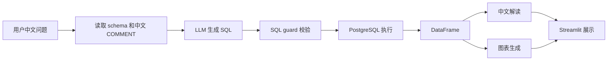

# 基金研究智能体项目说明

---

## 1. 项目概览：这个系统解决什么问题

本项目是一个面向中国公募基金研究场景的本地 NL2SQL 投研 Agent。用户用中文提问，系统自动生成 SQL、查询基金数据库，并返回数据表、图表和一段基于真实查询结果的中文解读。

一个典型问题是：

> 易方达蓝筹精选近三年各申万行业仓位的变化

系统的输出包括：

- 生成并执行的 SQL
- 查询结果表
- 自动选型的 Plotly 图表
- 简短中文分析

当前系统定位不是投顾，也不做收益预测，而是一个“可信取数 + 自动分析展示”的研究辅助工具。它解决的是基金研究中常见的几个问题：数据分散、SQL 门槛高、临时问题多、指标口径容易不一致、结果难以复查。

当前本地数据库规模：

| 数据对象 | 当前规模 |
|---|---:|
| 基金数量 | 149 只 |
| 净值记录 | 260,559 条 |
| 持仓记录 | 66,891 条 |
| 证券主数据 | 3,040 只 |
| 预计算业绩指标 | 596 条 |

数据范围：

- 净值日期：2001-12-18 至 2026-05-29
- 持仓报告期：2022-03-31 至 2025-12-31
- 申万一级/二级行业覆盖：2,898 / 3,040 只证券

建议插图：

> **截图 1：系统首页与一次完整问答结果**
>
> 待插入：Streamlit 页面截图，包含问题输入框、中文解读、图表、数据表。

---

## 2. 数据与 ETL：数据怎么来、怎么入库、怎么保证可用

系统的数据底座是 PostgreSQL。ETL 目前以 Python 脚本形式实现，重点是先把端到端链路跑通，并保证每一步的数据口径可解释、可复查。

主要数据来源：

- `akshare`：基金基础信息、净值、持仓、基金经理等公开数据
- 申万行业成分数据：用于给持仓证券补充申万一级、二级行业分类

当前 ETL 流程：

1. 构建基金池：`etl/build_universe.py`
2. 拉取基金基础信息与净值：`etl/load_funds.py`
3. 拉取基金持仓：`etl/load_holdings.py`
4. 拉取基金经理信息：`etl/load_managers.py`
5. 补充申万行业分类：`etl/load_sw_industry.py`
6. 预计算基金业绩指标：`etl/compute_fund_perf.py`
7. 执行数据质量检查：`etl/data_quality.py`

核心数据表：

| 表 | 作用 |
|---|---|
| `dim_fund` | 基金主数据，一只基金一行 |
| `dim_manager` | 基金经理主数据 |
| `bridge_fund_manager` | 基金与基金经理的任职关系 |
| `fact_nav` | 基金净值时序，包含单位净值、累计净值、日收益 |
| `fact_holding` | 基金持仓明细 |
| `dim_security` | 证券主数据，包含申万一级、二级行业 |
| `fact_fund_perf` | 预计算业绩指标 |

数据质量检查按严重程度分为三类：

- `FAIL`：完整性或口径错误，出现即应修复
- `WARN`：可疑值，需要人工判断
- `INFO`：覆盖率统计或预期内的数据缺口

当前检查结果：

| 类别 | 当前结果 |
|---|---:|
| FAIL | 0 |
| WARN | 2 |
| INFO | 2 |

当前 WARN/INFO 主要包括：

- 1 条单日收益绝对值超过 20% 的异常点
- 部分历史记录存在累计净值小于单位净值的情况
- 40 只基金暂无持仓数据
- 142 只持仓证券没有申万行业，多为港股、北交所或退市标的

这些问题目前没有阻断系统演示，但在后续扩大基金池和产品化前需要进一步处理。

建议插图：

> **截图 2：数据质量检查结果**
>
> 待插入：`python -m etl.data_quality` 的运行结果截图。

---

## 3. 语义层与指标口径：为什么不是让 LLM 直接写 SQL

这个项目的核心设计不是让 LLM 自由发挥写复杂 SQL，而是把高风险、易错的业务逻辑固化到数据库语义层中。LLM 只负责把用户问题路由到合适的表、视图或函数。

语义层的主要设计：

| 视图 / 函数 | 解决的问题 |
|---|---|
| `v_fund_perf_latest` | 每只基金每个固定区间的最新业绩指标 |
| `v_fund_holding_latest` | 每只基金最新一期全持仓个股明细 |
| `v_fund_top_holdings` | 每期持仓按权重排名，支持“前 N 大重仓股” |
| `v_fund_industry_alloc` | 申万一级行业配置 |
| `v_fund_industry_l2_alloc` | 申万二级行业配置 |
| `f_fund_perf_range()` | 任意自定义区间的业绩指标计算 |

例如，“前十大重仓股”不让模型临时写窗口函数，而是通过 `v_fund_top_holdings.holding_rank <= 10` 表达；“最新行业配置”不让模型自己判断最新报告期，而是通过 `is_latest` 字段表达。

业绩指标口径也被固定下来：

- 收益率基于累计净值 `acc_nav`
- 区间总收益 = 末值 / 首值 - 1
- 年化收益按 252 个交易日折算
- 波动率 = 日收益标准差 × √252
- 夏普比率默认无风险利率为 0
- 最大回撤基于累计净值的峰谷跌幅

固定区间走预计算：

- 今年以来：`YTD`
- 近一年：`1Y`
- 近三年：`3Y`
- 成立以来：`SI`

自定义区间走数据库函数：

```sql
SELECT d.fund_name, m.total_return, m.sharpe
FROM dim_fund d,
     LATERAL f_fund_perf_range(d.fund_code, '2023-01-01', CURRENT_DATE) m
WHERE d.fund_name LIKE '%易方达%';
```

这个设计修复过一个真实问题：早期如果让模型从净值表现场推导“成立以来累计收益”，曾出现过结果形态合理但口径错误的情况。现在固定区间由 `fact_fund_perf` 统一预计算，自定义区间由 `f_fund_perf_range()` 统一计算，避免模型临时拼公式。

建议插图：

> **截图 3：指标查询示例**
>
> 待插入：例如“易方达蓝筹精选成立以来的累计收益率是多少”的结果截图，展示 SQL、结果表和解读。

---

## 4. NL2SQL 与 SQL 准确性：中文问题如何变成可信查询

Agent 的核心入口是 `agent/pipeline.py` 中的 `ask()`。一次完整调用流程如下：



NL2SQL 的 prompt 由三部分组成：

1. 固定规则：只输出一条 `SELECT`，不要解释，不要把颜色、图表样式写进 SQL。
2. 数据库 schema context：运行时从 PostgreSQL 中读取表、列和中文 COMMENT。
3. 用户问题：原始中文输入。

准确性主要来自三层约束：

- 数据库语义层：视图和函数封装复杂逻辑
- prompt 护栏：约束模型使用方式
- 评测集：用固定问题检查返回值，而不只是检查 SQL 是否能运行

当前评测集在 `eval/cases.yaml` 中，覆盖这些类别：

- 净值走势
- 基金经理
- 持仓和前 N 大重仓股
- 基金元数据
- 收益、回撤、夏普、波动率
- 自定义区间指标
- 申万一级和二级行业配置

这里的评测不是只看“返回非空”，而是对部分问题检查结果中是否包含预期值。例如：

| 问题 | 检查点 |
|---|---|
| 张坤管理了哪些基金 | 结果包含“蓝筹”“优质精选” |
| 易方达蓝筹精选成立以来的累计收益率是多少 | 结果包含约 `0.60` |
| 白酒板块仓位最高的基金是哪只 | 结果包含“招商中证白酒” |
| 哪只基金重仓半导体行业最多 | 结果包含“申万菱信智能驱动” |


---

## 5. SQL 安全与可控性：如何限制 LLM 的执行范围

LLM 生成 SQL 的系统必须有执行边界。当前项目通过 `agent/sql_guard.py` 对模型生成的 SQL 做 AST 级校验，再交给数据库执行。

当前已实现的安全规则：

- 只允许恰好一条 SQL 语句
- 只允许 `SELECT`
- 禁止 `SELECT INTO`
- 只允许访问白名单表 / 视图前缀：
  - `dim_`
  - `fact_`
  - `bridge_`
  - `v_`
- 只允许白名单表函数：
  - `f_fund_perf_range`
- 如果模型没有写 `LIMIT`，自动补 `LIMIT 10000`
- 前端 admin 角色可看到生成 SQL，便于人工审计

这套机制能阻止大多数明显危险或越界的 SQL，例如多语句、写操作、访问系统表、访问未知表等。

但当前还有两个需要诚实说明的风险：

1. 本地应用当前连接数据库使用的是 `postgres` 用户，不是只读角色。
2. 当前 guard 主要检查表和表函数，仍需增强对 SELECT 列表中任意数据库函数的限制。

因此，项目当前安全状态可以概括为：

> 应用层已经有 SQL guard，但数据库权限层还没有完全收紧。下一步应该创建只读数据库角色，并补充更严格的函数白名单检查。

建议下一步加固：

- 新建只读用户，例如 `invest_readonly`
- 应用侧 `PG_CONN_STR` 改为只读用户
- 禁止访问非业务 schema
- 对 SELECT 列表中的函数调用做白名单限制
- 为 SQL guard 增加单元测试

建议插图：

> **截图 5：SQL guard 示例**
>
> 待插入：展示一个合法 SQL 被放行、一个非法 SQL 被拒绝的测试截图。

---

## 6. 可视化与前端交互：结果如何展示给用户

系统的可视化不是针对每个问题手写图表，而是根据查询结果的数据形状自动选择图表类型。

确定式图表推断规则：

| 数据形状 / 用户意图 | 图表类型 |
|---|---|
| 日期 × 数值 | 折线图 |
| 日期 × 类别 × 权重 / 占比 | 堆叠面积图 |
| 类别 × 数值 | 柱状图 |
| 两个数值指标 | 散点图 |
| 单期构成 / 占比 | 饼图 |

除了确定式推断，系统还有一层声明式图表 spec：

- LLM 不生成绘图代码
- LLM 只生成受控 JSON，例如图表类型、x/y/color 映射、排序方式
- 系统校验 JSON 中引用的列名必须真实存在
- 校验通过后由统一的 Plotly 渲染器生成图表

这种方式把“模型提议”和“系统执行”分开，避免让 LLM 直接生成 Python 绘图代码。

前端使用 Streamlit，主要能力包括：

- 登录鉴权
- `admin` / `viewer` 两种角色
- `admin` 可查看 SQL 和完整数据
- `viewer` 只能查看解读、图表和截断数据
- 支持就地图表修改

就地图表修改示例：

| 用户指令 | 系统行为 |
|---|---|
| 换成柱状图 | 不重新查询数据库，直接基于上一份结果重绘 |
| 改成红色 | 不调用 LLM，不重新生成 SQL，只修改图表颜色 |
| 换成饼图 | 如果当前数据形状适合饼图，则重绘 |

图表回归测试在 `eval/charts.py` 中，目前结果为：

| 测试项 | 当前结果 |
|---|---:|
| 确定式图表推断 | 6 / 6 |
| 声明式 spec 渲染 | 5 / 5 |
| 颜色映射离线测试 | 1 / 1 |
| 合计 | 12 / 12 |

建议插图：

> **截图 6：行业仓位堆叠面积图**
>
> 待插入：问题“易方达蓝筹精选近三年各申万行业仓位的变化”的图表截图。

> **截图 7：图表就地修改**
>
> 待插入：同一份数据被“换成柱状图”或“改成红色”后的截图。

---

## 7. 展示性问题设计

下面这些问题适合放在文档或 demo 截图中，覆盖项目的主要能力。

| 展示问题 | 展示重点 | 预期图表 / 输出 |
|---|---|---|
| 易方达蓝筹精选今年的单位净值走势 | 基础净值时序查询 | 折线图 |
| 对比易方达蓝筹精选和华夏成长今年的净值走势 | 多基金对比 | 多线折线图 |
| 易方达蓝筹精选成立以来的累计收益率是多少 | 指标口径与预计算 | 表格 + 中文解读 |
| 成立以来夏普比率最高的三只基金 | 指标排名 | 柱状图 |
| 易方达蓝筹精选最新前五大重仓股 | 持仓排名语义层 | 柱状图 / 表格 |
| 易方达蓝筹精选近三年各申万行业仓位的变化 | 行业配置时序 | 堆叠面积图 |
| 白酒板块仓位最高的基金是哪只 | 申万二级行业路由 | 排名表 / 柱状图 |
| 2023 年以来年化收益率最高的基金是哪只 | 自定义区间函数 | 排名表 / 柱状图 |
| 所有基金今年以来年化收益率与波动率的关系 | 双指标关系 | 散点图 |
| 把这张图换成柱状图 | 前端就地修改 | 同数据重绘 |

建议插图：

> **截图 8：展示性问题合集**
>
> 待插入：可以选 3 到 5 个最有代表性的问题，每个问题配一张截图。


---

## 附录：项目文件结构

```text
agent/
  clients.py        LLM 客户端抽象，支持 DeepSeek / Claude
  pipeline.py       NL2SQL、查询执行、解读、图表生成主链路
  sql_guard.py      SQL 安全校验

etl/
  build_universe.py       构建基金池
  load_funds.py           基金基础信息与净值
  load_holdings.py        基金持仓
  load_managers.py        基金经理
  load_sw_industry.py     申万行业补全
  compute_fund_perf.py    业绩指标预计算
  data_quality.py         数据质量检查

eval/
  cases.yaml        NL2SQL 评测集
  run_eval.py       NL2SQL 评测执行脚本
  charts.py         图表回归测试

sql/
  schema.sql        数据库 schema、视图、函数、pgvector 表

web/
  app.py            Streamlit 前端

training_data/
  qsql/             后续检索增强用的问题-SQL 样例
```


